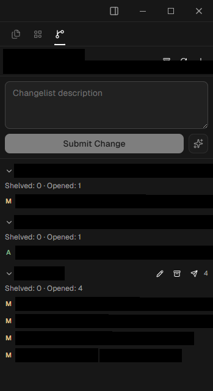
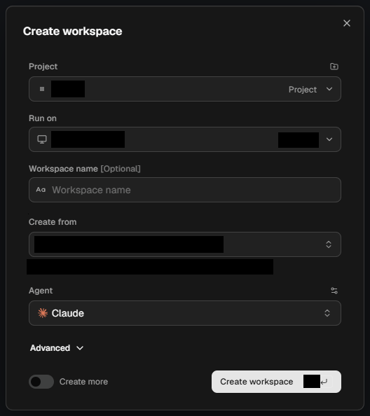
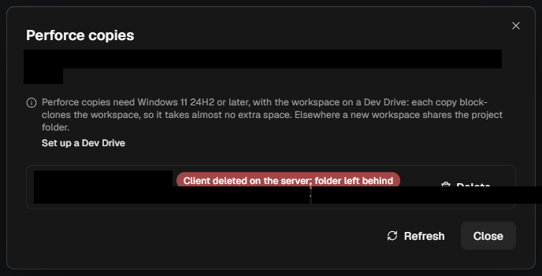
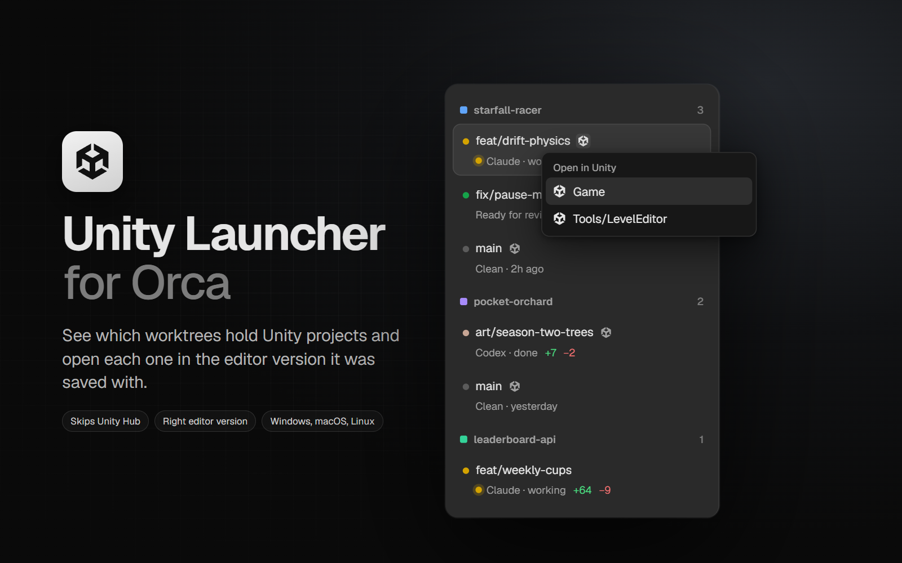

# Orca for Perforce and Unity

**A community build of [Orca](https://github.com/stablyai/orca), the app for running AI coding agents side by side, with Perforce (Helix Core) support and Unity integration for game development.**

Orca runs Claude Code, Codex, OpenCode and other coding agents in parallel, each in its own workspace. Upstream Orca builds those workspaces on Git worktrees. This build adds the same workflow for **Perforce** depots and makes **Unity** projects one click away, for game studios whose projects live in Perforce.

[**Download for Windows**](https://github.com/ggrafhalfbrick/orca/releases/latest) · [What's new](https://github.com/ggrafhalfbrick/orca/releases) · [Upstream Orca](https://github.com/stablyai/orca) · [Orca docs](https://www.onorca.dev/docs)

> This is an unofficial build, not affiliated with stablyai or with Perforce Software or Unity Technologies. Its features are proposed upstream; once they land there, the official Orca is the better choice.

## Orca Perforce support

Open a folder inside a Perforce client workspace and Orca treats it like a Git project.

- **Source Control panel for Perforce:** default and numbered changelists, "Modified, not opened" and new files, diffs against `#have`, shelves, submit, sync, moving files between changelists, and AI-drafted changelist descriptions. Read-only files are opened for edit when you save them, automatically or after asking.
- **A Perforce copy per agent:** **Create workspace** in a Perforce project gives each agent its own copy of the workspace, the way Git projects get a worktree. A copy has its own folder, its own client and, by default, its own stream. You can also start on a stream that already exists, for example to continue a teammate's work.
- **Copies that cost almost nothing:** a copy is block-cloned on a Windows 11 Dev Drive (ReFS) or cloned on macOS APFS, so an 80 GB Unity workspace takes about 1 GB of disk until files change.
- **Everywhere Orca runs:** on your computer, over SSH, and on a paired Orca server. `p4` only needs to be installed where the workspace is.

  
  

Upstream proposal: [stablyai/orca#26298](https://github.com/stablyai/orca/pull/26298).

## Orca Unity integration

The bundled **Unity Launcher** plugin marks every workspace that holds a Unity project with the Unity icon. Pick a project from the icon, or right-click the workspace and choose **Open in Unity**, and it opens in the exact Unity Editor version the project was saved with.

- No Unity Hub juggling: workspaces are never added to Hub, so agent workspaces come and go without cleanup.
- Finds Unity projects in subfolders (`Game/`, `Tools/LevelEditor/`) and lists each one.
- Never opens a project with the wrong editor version. If that version isn't installed, it names the versions you have.
- On Windows, the editor gets the same environment variables Unity Hub gives it.

Upstream proposal for the plugin feature it needs: [stablyai/orca#40557](https://github.com/stablyai/orca/pull/40557). Once that ships, Unity Launcher will also be listed in the Orca plugin directory for official Orca.

## Install

1. Download `orca-windows-setup.exe` from the [latest release](https://github.com/ggrafhalfbrick/orca/releases/latest) and run it. The installer is unsigned, so Windows SmartScreen warns about an unknown publisher the first time; choose **More info**, then **Run anyway**.
2. Orca offers each later release of this build as an in-app update. It doesn't switch you to official Orca releases, which would drop these features.

For Perforce, install the [Helix Core command-line client (`p4`)](https://www.perforce.com/downloads/helix-command-line-client-p4) and sign in with `p4 login`. For Perforce copies, keep your workspaces on a Dev Drive (Windows 11) or an APFS volume (macOS).

## Everything else

Agents, terminals, the mobile companion, the browser, SSH and the rest work as in upstream Orca; see the [Orca README](https://github.com/stablyai/orca#readme) and [docs](https://www.onorca.dev/docs). This build follows upstream `main` closely and is MIT-licensed like Orca.

Keywords: Orca Perforce, Orca Unity, Perforce Helix Core AI coding agent, Perforce worktrees, Unity AI coding agent, Claude Code with Perforce, Codex with Perforce, Unity Editor launcher, game development AI agents.
